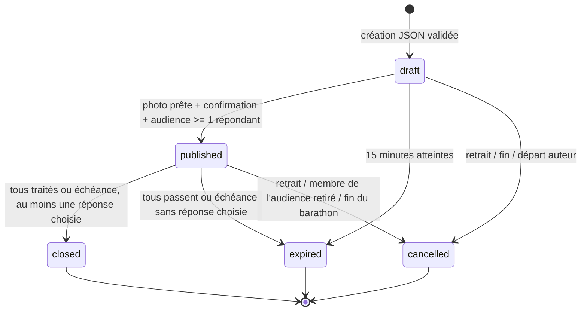

# PHOTO-001 — Architecture et contrats d'implémentation

**Statut : conception, non implémentée.** Ces règles sont normatives pour le MVP. Contexte et verdict : [AUDIT.md](AUDIT.md). Sécurité et exploitation des fichiers : [SECURITY-RGPD.md](SECURITY-RGPD.md). Toute simplification qui diminue une garantie impose un nouvel audit et conserve le flag désactivé.

## 1. Périmètre et valeurs par défaut

- Jeu disponible pour les barathons SQL `started`, explicitement autorisés pour l'essai par une allowlist serveur. Aucune déduction depuis la seule date ou `has_started`.
- Membres **non invités** uniquement : `User.is_guest=false` relu en SQL, compte existant, lien `BarathonParticipant` actuel. L'organisateur informe les utilisateurs QR de cette restriction avant la soirée. Un admin extérieur n'a aucun droit de lecture.
- De 2 à 20 comptes non invités présents à publication, créateur du défi inclus. Les invités ne comptent pas dans cette limite et ne reçoivent aucun contenu du jeu. Plus de 20 : publication refusée, ne pas choisir arbitrairement un sous-groupe.
- Tout membre éligible peut créer, indépendamment des rôles. Le créateur du défi peut être différent du créateur du barathon.
- Un seul défi `published` par barathon ; un seul `draft` par auteur et barathon ; un seul draft par auteur globalement pour l'essai. Maximum 20 créations de drafts par barathon sur 24 h, y compris abandons ; la borne est assumée pour maîtriser abus et stockage.
- Trois créations maximum par auteur sur 10 min, cinq publications par heure et une publication par minute par auteur, tous barathons confondus. Limites persistantes dans `photo_rate_events`, indépendantes de la suppression d'un barathon ; les retraits de contenu laissent aussi un tombstone minimal pour la fenêtre d'idempotence.
- Question : 3 à 180 caractères Unicode après trim ; 2 à 4 propositions, 1 à 60 caractères chacune après trim ; unicité après normalisation NFKC + casefold. Texte brut, aucun HTML, lien actif ou Markdown interprété. Une seule bonne réponse, index 0-based.
- Draft valable 15 min, jamais prolongé par un retry. Défi publié : 3 minutes, calculées à l'horloge serveur ; pas de clôture anticipée discrétionnaire par l'auteur.
- Caméra uniquement. Pas de galerie, vidéo, Live Photo, import d'URL, sauvegarde en photothèque ni partage de fichier dans le MVP.
- Upload source normalisé côté mobile : JPEG, ≤ 2 MiB. Serveur accepte réellement JPEG/PNG fixes uniquement, ≤ 2 097 152 octets, ≤ 6 millions de pixels, côté ≤ 4096 ; sortie JPEG RGB, côté ≤ 1600, ≤ 524 288 octets.
- Un décodage/upload actif par processus ; saturation refusée avec `429` et `Retry-After`, pas de file en RAM. Plafond photo global 100 MiB chiffrés et 200 médias non purgés ; PVC 1 Gi envisagé, capacité physique à vérifier. Ne pas présumer qu'un PVC local-path impose un quota disque effectif.
- Gages affichés comme propositions facultatives : « Mime un objet pendant 10 secondes », variante calme/sans alcool « Choisis le prochain thème », et bouton **Passer**. Aucune quantité de boisson, dette, score de consommation ou sanction pour refus. Pas de gage libre saisi par l'auteur.

## 2. États, audience et résultats

### Machine à états



Un média possède son propre état de purge ; effacer la photo d'un défi `closed` ne change pas son résultat en `cancelled`. Les états terminaux sont immuables. Le retrait de contenu après clôture peut supprimer/rédiger les données, jamais recalculer le résultat.

### Audience et révocation

À publication, le serveur fige tous les liens des membres non invités actuels. Une ligne d'audience est créée pour l'auteur (`is_creator=true`), les autres sont les répondants. Un défi avec l'auteur seul est refusé. L'identité d'une place est liée à **l'instance de participation**, pas seulement au `user_id` : départ puis retour crée un autre lien et ne rétablit pas l'accès aux anciens défis.

Pour lire un défi, sa photo ou ses résultats : JWT valide + compte non invité + participation actuelle correspondant exactement au lien capturé + ligne d'audience non révoquée + contenu non retiré + rétention non échue. En draft, seul l'auteur avec son lien initial courant peut voir le contenu. Les nouveaux arrivants ne voient pas les anciens défis, même après clôture ; ils participent aux publications suivantes. L'organisateur ne peut pas consulter un draft d'autrui.

Avant clôture, retrait effectif d'un membre de l'audience (répondant ou auteur) : **annuler le défi entier**, aucun gage. C'est une règle volontairement simple et non manipulable par recalcul d'un dénominateur. Retrait d'un membre arrivé après publication : aucun effet sur ce défi. Une déconnexion n'est pas un départ et ne change pas l'audience.

Après clôture, départ/exclusion : accès de cette personne révoqué ; résultat figé des autres conservé. Retrait de l'auteur : retirer aussi toutes ses photos. Suppression du compte d'un répondant : retirer son association personnelle et sa réponse, garder seulement les totaux déjà calculés jusqu'au TTL, sans recalcul. Les DTO indiquent alors que des données individuelles ont été retirées ; le MVP n'affiche de toute façon que des agrégats et le résultat personnel.

Fin normale, arrêt ou suppression du barathon : dans la transaction de cycle de vie, annuler tous ses drafts et défis publiés, retirer toutes ses photos, sans attribuer de nouveau gage. Les résultats déjà clos peuvent rester consultables **sans photo**, par l'audience encore membre, jusqu'au TTL de 24 h. Le bouton de jeu ne s'affiche plus ; un lien « Résultats Photo Mystère » en lecture seule peut figurer dans le récapitulatif. Suppression physique du barathon : supprimer aussi tous les résultats ; la liste de purge fichiers survit aux cascades.

### Calcul serveur

Soit E l'ensemble figé des répondants, taille n ≥ 1 ; C les réponses correctes, W les réponses incorrectes, P les abstentions explicites et U les personnes sans soumission à l'échéance. Ces ensembles sont disjoints et couvrent E à la clôture. « Passer le défi » crée une abstention définitive, différente de « Passer le gage » qui n'affecte aucun résultat.

- Si `|C| + |W| = 0` : `expired`, aucun résultat gagnant/perdant, aucun gage, bonne réponse non dévoilée.
- Sinon : `closed`. Si `|C| = n`, gage facultatif pour l'auteur uniquement.
- Sinon : gage facultatif pour W uniquement. P et U ne sont jamais sanctionnés. Des réponses toutes correctes parmi les présents ne suffisent pas à sanctionner l'auteur si quelqu'un manque.
- Si tous ont soumis réponse ou abstention avant l'échéance, terminaliser immédiatement. Sinon, à `now >= expires_at`. Une réponse reçue à l'échéance ou après n'est pas acceptée, même si le watcher n'est pas passé.

Exemples : deux répondants corrects → auteur ; un correct + un faux → faux ; un correct + un absent → personne ; tous absents ou tous Passer → expiration sans gage. Un seul répondant éligible peut jouer : correct → auteur, faux → répondant.

## 3. Schéma PostgreSQL

Nouvelle révision additive après `a7b8c9d0e1f2`, à rebaser sur la tête réellement retenue au démarrage du lot. Pas de renommage ou d'altération des tables métier existantes. Noms proposés dans `app/models.py` ; nouveaux schemas Pydantic dans `app/photo_schemas.py` pour éviter de sérialiser les ORM génériques. UTC en `TIMESTAMPTZ`, UUID v4, `CHECK` textuels plutôt qu'un ENUM partagé.

### `photo_challenges`

- `id UUID PK` généré serveur ; `barathon_id INTEGER NOT NULL FK barathons ON DELETE CASCADE`.
- `creator_user_id INTEGER NULL FK users ON DELETE SET NULL`, `creator_membership_id INTEGER NULL FK barathon_participants ON DELETE SET NULL`. Null signifie absence de droit, jamais accès anonyme.
- `state TEXT NOT NULL CHECK IN ('draft','published','closed','cancelled','expired')`.
- `question TEXT NULL`, `options JSONB NULL`, `correct_index SMALLINT NULL` : null uniquement après retrait de contenu. `content_removed_at TIMESTAMPTZ NULL` permet des tombstones sans texte ni bonne réponse.
- Tant que `content_removed_at IS NULL` : question non nulle longueur 3..180, options tableau JSONB de longueur 2..4, `0 <= correct_index < jsonb_array_length(options)`. Validation Pydantic stricte de chaque chaîne, unicité/normalisation ; un validateur SQL de forme ou des CHECK JSONPath doivent aussi interdire options non textuelles/hors longueur. Tester les écritures SQL invalides directement. Ne pas accepter un booléen comme index entier.
- `create_key UUID NOT NULL`, `create_fingerprint CHAR(64) NOT NULL`, `notice_version VARCHAR(32) NOT NULL`, `confirmed_at TIMESTAMPTZ NULL`.
- `created_at`, `draft_expires_at`, `retention_until TIMESTAMPTZ NOT NULL` ; `published_at`, `expires_at`, `terminal_at TIMESTAMPTZ NULL` ; `terminal_reason TEXT NULL` ; `version BIGINT NOT NULL DEFAULT 1 CHECK(version>0)`.
- `expected_count SMALLINT NULL CHECK(expected_count BETWEEN 1 AND 19)` ; `result_seen` est individuel, pas dans cette table.
- `UNIQUE(creator_user_id, create_key)` ; index `(barathon_id, created_at DESC)`, `(creator_user_id, created_at DESC)`, `(creator_user_id, published_at DESC)` ; index d'expiration par état ; index `retention_until`.
- Index unique partiel `(barathon_id) WHERE state='published'` ; unique partiel `(creator_user_id) WHERE state='draft'` (impose aussi la règle par barathon).
- CHECK de cohérence temporelle : draft sans dates de publication/fin ; published avec dates de publication/expiration et sans terminal_at ; terminaux avec terminal_at ; closed implique published_at et expected_count. `retention_until=created_at+24h` est fixé par le serveur et jamais repoussé.

Le tombstone conserve seulement IDs pseudonymes, dates, état et clé/fingerprint pendant 24 h pour retries et quotas. Suppression de compte : nullifier les liens auteur et purger les données personnelles associées sans attendre ce délai.

Pour rendre le contrôle JSONB déterministe, créer dans la migration une fonction SQL pure `photo_valid_options(jsonb) RETURNS boolean IMMUTABLE`, utilisée par le CHECK : `CASE WHEN jsonb_typeof(v)='array' THEN jsonb_array_length(v) BETWEEN 2 AND 4 AND NOT EXISTS (SELECT 1 FROM jsonb_array_elements(v) AS x(value) WHERE jsonb_typeof(value)<>'string' OR char_length(value #>> '{}') NOT BETWEEN 1 AND 60) ELSE false END`. Traiter explicitement NULL dans le CHECK. Le service stocke seulement des chaînes déjà normalisées/trim et applique l'unicité Unicode ; le CASE évite d'appeler jsonb_array_length sur un objet. Prévoir l'équivalent JSON/validation pour les tests SQLite, mais PostgreSQL reste la référence.

### `photo_audience`

- `id UUID PK`, `challenge_id UUID NOT NULL FK photo_challenges ON DELETE CASCADE`.
- `user_id INTEGER NULL FK users ON DELETE SET NULL` ; `membership_id INTEGER NULL FK barathon_participants ON DELETE SET NULL` ; `is_creator BOOLEAN NOT NULL`.
- `revoked_at TIMESTAMPTZ NULL`, `result_seen_at TIMESTAMPTZ NULL`, `dare_assigned BOOLEAN NULL` (NULL avant closed), `personal_data_removed_at TIMESTAMPTZ NULL`.
- `UNIQUE(challenge_id,user_id)`, `UNIQUE(challenge_id,id)` pour FK composite des réponses ; index `(user_id,challenge_id)` ; unique partiel `challenge_id WHERE is_creator=true`.
- Aucune copie de pseudo/email. Joindre `users` uniquement quand nécessaire. `membership_id IS NULL` ou révocation interdit toujours l'accès, même si l'utilisateur rejoint à nouveau.

### `photo_answers`

- `challenge_id UUID NOT NULL`, `audience_id UUID NOT NULL`, PK `(challenge_id,audience_id)` ; FK composite vers `photo_audience(challenge_id,id) ON DELETE CASCADE`.
- `choice_index SMALLINT NULL`, `passed BOOLEAN NOT NULL`, `submitted_at TIMESTAMPTZ NOT NULL`.
- CHECK : `(passed AND choice_index IS NULL) OR (NOT passed AND choice_index BETWEEN 0 AND 3)`.
- Le service sous verrou exige en plus `choice_index < len(options)`, audience non auteur, droit courant et défi published avant échéance. Pas d'UPDATE d'une réponse acceptée. Les requêtes ne prennent jamais de `user_id` ni d'`audience_id` fournis par le client.

### `photo_results`

- `challenge_id UUID PK FK photo_challenges ON DELETE CASCADE`, `closed_at TIMESTAMPTZ NOT NULL`, `reason TEXT CHECK IN ('all_handled','deadline')`.
- `expected_count`, `correct_count`, `incorrect_count`, `passed_count`, `missing_count` SMALLINT NOT NULL, tous ≥0 ; `expected_count = correct_count+incorrect_count+passed_count+missing_count` et ≥1.
- `creator_dare BOOLEAN NOT NULL`, CHECK équivalent à `correct_count=expected_count` ; au moins une réponse choisie pour avoir une ligne de résultat.
- Une seule ligne, créée dans la même transaction que `state=closed` et les `dare_assigned`. Pas de champ JSON libre de résultat fourni par mobile. Les totaux sont le constat au moment de clôture et ne changent pas lors d'une demande d'effacement individuelle.

L'invariant « closed possède un résultat » s'applique tant que `content_removed_at IS NULL`. Un retrait complet laisse un tombstone closed sans photo_results ; ce n'est ni une nouvelle clôture ni un score vide à afficher.

### `photo_media`

- `id UUID PK`, `challenge_id UUID NULL FK photo_challenges ON DELETE SET NULL` : **pas de cascade de suppression de cette ligne**, car elle est aussi le registre durable de purge.
- `storage_key UUID UNIQUE NOT NULL` non exposée, `state TEXT CHECK IN ('staged','ready','delete_pending','deleted')`.
- `key_id VARCHAR(32)`, `nonce BYTEA`, `input_sha256 CHAR(64)` internes ; unicité `(key_id,nonce)` ; taille nonce 12 octets quand ready.
- `cipher_bytes INTEGER`, `jpeg_bytes INTEGER`, `width INTEGER`, `height INTEGER` ; CHECK des bornes et MIME de sortie fixe `image/jpeg` ; pas de nom original/EXIF/GPS.
- `created_at`, `purge_due_at TIMESTAMPTZ NOT NULL`, `delete_requested_at`, `next_attempt_at`, `deleted_at TIMESTAMPTZ NULL`, `attempt_count INTEGER NOT NULL DEFAULT 0`.
- Index unique partiel `(challenge_id) WHERE state IN ('staged','ready')` ; index `(state,next_attempt_at)`, `purge_due_at`. Une écriture invalidée se détache du challenge après nettoyage pour permettre un nouvel essai.
- La perte de `challenge_id` implique purge, jamais objet orphelin servi. Les tombstones de fichier sont supprimés après confirmation d'absence physique et fin de la rétention de diagnostic, 24 h maximum.

### `photo_rate_events`

- `id BIGINT GENERATED BY DEFAULT AS IDENTITY PK`, `user_id INTEGER NOT NULL FK users ON DELETE CASCADE`, `operation_id UUID NOT NULL`, `kind TEXT CHECK IN ('draft_create','publish')`, `occurred_at TIMESTAMPTZ NOT NULL`.
- `UNIQUE(operation_id,kind)` et index `(user_id,kind,occurred_at)`. operation_id est l'UUID serveur du défi ; **pas de FK vers le défi ou le barathon**, pour qu'une suppression de ces objets ne réinitialise pas les quotas globaux d'auteur.
- Insérer seulement avec la première création/publication réussie, dans la même transaction ; retries sans nouvelle ligne. Sous verrou du compte auteur, compter les événements dans les fenêtres 10min/1min/1h avant insertion. Purger les événements âgés de plus d'une heure ; supprimer immédiatement ceux d'un compte supprimé.
- Aucun texte, photo, IP ni résultat. Les limites de lecture et les tentatives d'upload invalides utilisent en plus un limiteur mémoire borné par user_id (20 lectures/min avec burst20, 6 tentatives upload/min) ; il peut repartir à zéro après restart mais les quotas métier et le plafond stockage persistent. Pour les réponses légitimes, les retries restent possibles et bornés à 20/min par compte.

Les permissions SQL applicatives ne doivent pas permettre au client de contourner ces services. Les règles intertables (auteur exclu, résultat seulement closed, état immuable) sont des invariants transactionnels testés ; les FK/uniques/CHECK couvrent les cas locaux, elles ne remplacent pas le verrou.

## 4. Transactions, concurrence et idempotence

### Ordre de verrouillage obligatoire

Pour toute mutation Photo issue d'un utilisateur : compte acteur `FOR UPDATE` → barathon `FOR UPDATE` → challenge → média, puis audience/réponses. Les watchers sans acteur commencent au verrou barathon ; ils ne prennent jamais ensuite un verrou compte. Pour plusieurs barathons/challenges, ordre croissant d'ID. Les chemins existants de retrait, fin, suppression et suppression de compte doivent prendre le même verrou de barathon avant de modifier les liens ou l'état ; les opérations sur un compte cible ne doivent pas inverser cet ordre. Supprimer un compte prend le compte cible, puis ses barathons triés ; la révocation d'un autre membre n'a pas besoin de verrouiller son compte après le barathon.

La sérialisation du compte acteur protège les quotas globaux ; la ligne barathon protège la publication, l'audience, l'annulation et la dernière réponse. Toutes les données doivent être relues sous verrou (`populate_existing` ou nouvelle session) : les relations chargées avant le verrou sont insuffisantes. Pas d'envoi WS, d'attente réseau client ni de décodage sous verrou. Sessions synchrones confinées au même thread de travail ; ne pas partager une Session entre tâches.

### Soumission / clôture

1. Authentifier, verrouiller dans l'ordre, recharger les droits et le statut réel du barathon.
2. Si une réponse existe : même choix/Passer → 200 sans modification ; choix différent → 409. La vérification des droits précède toujours ce replay. Pour une réponse déjà commise, le replay reste possible après clôture dans la fenêtre de rétention, en retournant le DTO courant autorisé.
3. Si aucune réponse : vérifier `published`, audience répondante et `clock_timestamp() < expires_at`. Utiliser l'heure DB **après** l'attente du verrou ; `now()` transactionnel peut être antérieur à une longue attente.
4. Insérer ; la PK interdit le doublon même en présence d'un défaut de code. En conflit, relire et appliquer la règle de replay, ne pas renvoyer 500.
5. Si tous traités ou échéance : calculer E/C/W/P/U ; une primitive `finalize_locked` idempotente passe à closed/expired. INSERT résultat PK unique et transition état/version dans la même transaction. Deux finaliseurs ne produisent qu'une ligne et un seul instant de clôture.
6. Commit ; notifier en best effort. Si commit réussi et émission WS échouée, la réponse HTTP ne prétend pas que le vote a échoué : le client et le polling retrouvent le résultat SQL.

Course réponse/fin : le premier détenteur du verrou barathon détermine l'ordre. Si la dernière réponse clôt avant la fin, le résultat reste clos et la fin retire la photo ; si la fin gagne, défi cancelled et réponse refusée. Course révocation/lecture : lecture autorisée à son point de contrôle peut déjà être en cours ; après commit de révocation, toute nouvelle requête est refusée. Les octets déjà reçus ne sont pas récupérables.

### Autres retries

- Création : en-tête `Idempotency-Key: UUIDv4`, clé unique auteur + empreinte canonique de tout le corps accepté (question/options/bonne réponse/notice_version). Même clé et même corps → même ressource, même expiration ; corps différent → 409. Valable 24 h, seulement tant que l'acteur conserve ses droits. Tombstone retiré : 410, ne pas reconstruire un contenu supprimé.
- Upload : `PUT` unique du média d'un draft. Empreinte des octets entrants enregistrée, non renvoyée. Replay identique après succès → même média, y compris si la publication a entretemps réussi ; différent → 409. Aucun remplacement après succès : annuler/recréer pour changer de photo. Les refus transitoires sans média ready permettent de réessayer.
- Publication : payload vide hormis confirmation de notice ; depuis published/closed, même confirmation → représentation courante sans republier ni renotifier. Audience créée une seule fois.
- Retrait : DELETE répété par un acteur toujours autorisé → 204 ; ressource inconnue/hors audience → 404 uniforme. Ne pas rétablir un média retiré.
- Résultat vu : PUT répétable, n'affecte pas le résultat ; horodatage initial conservé.

### Watchers et reprise

Boucle toutes les 5 s dans `lifespan`, limitée à 20 challenges par lot, finalisation sous les mêmes verrous ; récupération des échéances au démarrage. L'API appelle aussi la finalisation sur lecture/soumission si l'échéance est dépassée. Horloge SQL, pas un timer React. Un pod arrêté ne répond pas et perd ses sockets, mais conserve votes/échéances en SQL. La disponibilité n'est pas garantie pendant `Recreate`.

Purge fichiers toutes les 30 s, par lots bornés, active même lorsque le jeu est désactivé. Un watchdog de santé de purge doit être disponible à l'opérateur sans données personnelles. Retard >5 min : alerte et arrêt des nouveaux uploads. Aucun Redis/Celery/broker nécessaire.

## 5. API REST normative

Préfixe de jeu : `/barathons/{barathon_id}/photo-mystery`. Toutes les routes exigent Bearer, pas de cookie ou jeton dans l'URL ; `extra='forbid'` sur les corps. Routes read-only sans corps. Codes uniformes, `Cache-Control: private, no-store` sur toutes les réponses Photo, erreurs incluses. La photo et les DTO ont la même politique d'autorisation.

### Disponibilité et inventaire

`GET /barathons/{b}/photo-mystery` : snapshot complet, maximum 20 éléments, sans pagination pour le MVP borné. Sérialiser un snapshot cohérent dans une transaction ; finaliser les échéances avant lecture finale, sans modifier de vote. Aucune image inline.

```json
{
  "server_time": "2026-10-30T19:00:00Z",
  "enabled": true,
  "can_create": true,
  "pending_count": 1,
  "unseen_results_count": 0,
  "items": [{
    "id": "f66c8890-f13f-42b8-927e-c043302e599c",
    "version": 3,
    "state": "published",
    "question": "Cette bière est-elle blonde ou brune ?",
    "expires_at": "2026-10-30T19:03:00Z",
    "my_submission": null,
    "can_answer": true,
    "photo_available": true
  }]
}
```

`enabled=false`, liste vide et compteurs zéro si flag off pour un membre autorisé ; statut planned → jeu inactif. En état terminal du barathon, seuls résultats clos autorisés sans photo. Un guest reçoit 403 `PHOTO_ACCOUNT_REQUIRED` ; extérieur/inconnu 404. Avant création de tout challenge, l'autorisation de cet endpoint repose sur la participation actuelle et le compte non invité, jamais sur une audience inexistante.

### Créer un draft

`POST /barathons/{b}/photo-mystery/challenges`, Idempotency-Key obligatoire, 201 création / 200 replay :

```json
{
  "question": "Cette bière est-elle blonde ou brune ?",
  "options": ["Blonde", "Brune"],
  "correct_index": 0,
  "notice_version": "photo-private-2026-10-v1"
}
```

Réponse : `id`, `version`, `state=draft`, `question`, `options`, `draft_expires_at`, `photo_available=false`. **Pas de `correct_index` dans le DTO de réponse**, même pour le créateur. Sa saisie reste en RAM tant que le formulaire est ouvert. Après redémarrage, annuler un draft si la saisie correcte n'est plus connue ; pas d'endpoint d'édition nécessaire au MVP.

### Upload et publication

`PUT /.../challenges/{c}/photo`, corps binaire JPEG/PNG, `Content-Type` correspondant ; ni multipart, ni base64 JSON, ni URL à télécharger. 201 prêt / 200 retry identique. Réponse `{ "photo_available": true, "width": 1200, "height": 1600, "version": 2 }`. Aucun chemin physique ou hash.

`POST /.../challenges/{c}/publish` : `{ "confirmed": true, "notice_version": "photo-private-2026-10-v1" }`. Confirmation false/notice obsolète → 422. Capture de l'audience, `published_at`, `expires_at` et `confirmed_at` dans la transaction ; 200 DTO public. Auteur courant uniquement, photo prête non expirée obligatoire. La publication est l'acte de diffusion ; le draft reste privé.

### Lire et répondre

`GET /.../challenges/{c}` : DTO détaillé autorisé, sans bonne réponse avant closed ; options indexées, question, deadline, `can_answer`, `my_submission` (son propre choix/Passer, jamais sa correction avant clôture), `photo_available`. Pas de réponses individuelles des autres, ni liste de bons/mauvais, ni compteur révélant la progression individuelle.

`GET /.../challenges/{c}/photo` : 200 JPEG, après autorisation fraîche, état draft auteur / published audience / closed audience tant que barathon started et média retenu. Pas de redirection S3/CDN. `Content-Type: image/jpeg`, `Content-Length` borné, `Cache-Control: private, no-store, max-age=0`, `Pragma: no-cache`, `Vary: Authorization`, `X-Content-Type-Options: nosniff`, `Content-Disposition: inline; filename="photo.jpg"`. Pas de `ETag`/304 ni chemin alternatif non protégé. HEAD applique exactement les mêmes droits ou est explicitement refusé ; Range n'est pas supporté (réponse complète bornée après auth ou 416).

`PUT /.../challenges/{c}/answer` : soit `{ "choice_index": 1 }`, soit `{ "pass": true }`, exclusifs. 201 première soumission / 200 même replay ; 409 choix déjà différent ou défi terminé. Un index d'un autre défi ou hors bornes → 422. L'utilisateur provient uniquement du JWT validé. Réponse `{ "accepted": true, "state": "published", "my_submission": { "choice_index": 1 }, "version": 4 }` ; si cette soumission clôture, rendre state closed et demander le détail. Aucun `is_correct` avant closed, y compris via erreurs/temps de réponse volontaires.

### Résultats et retrait

Dans `GET /.../challenges/{c}` après closed, ajout de :

```json
{
  "result": {
    "correct_index": 0,
    "expected_count": 3,
    "correct_count": 1,
    "incorrect_count": 1,
    "passed_count": 0,
    "missing_count": 1,
    "creator_dare": false,
    "my_outcome": "incorrect",
    "my_dare_assigned": true,
    "dare": {
      "suggestion": "Mime un objet pendant 10 secondes",
      "alternative": "Choisis le prochain thème",
      "can_skip": true
    }
  }
}
```

`my_outcome` parmi `creator/correct/incorrect/passed/missing`. Aucun tableau nominatif de réponses dans le MVP. Le gage n'est proposé qu'à son destinataire. Son acceptation/refus n'est pas persistée. La bonne réponse figure seulement dans ce sous-objet de closed, jamais dans les listes, WS, métriques ou logs. cancelled/expired : motif générique, pas de result ni de correct_index.

`PUT /.../challenges/{c}/result-seen` avec `{}` : closed uniquement, membre audience courant ; 204. Expired/cancelled n'ajoutent pas de badge de résultat.

`DELETE /.../challenges/{c}` : retrait de contenu par auteur, **tout membre courant de l'audience** (signalement privé immédiat privilégiant la sécurité), ou organisateur courant non invité. L'organisateur peut retirer un défi publié sans obtenir une lecture d'un draft étranger. Draft : auteur uniquement. Admin global peut faire un retrait aveugle via procédure support dédiée auditée, sans endpoint de lecture automatique. Transaction : terminaliser cancelled si ouvert, effacer question/options/correct_index/réponses/résultat personnel et agrégé si retrait complet, marquer média delete_pending ; 204 après retrait logique. L'état closed d'un tombstone reste closed mais n'expose plus son ancien résultat. Le TTL de purge reste inchangé ou est avancé, jamais repoussé.

### Erreurs et ordre des contrôles

- 401 jeton absent/invalide/expiré ou compte supprimé. Normaliser le défaut de HTTPBearer pour ce contrat si nécessaire, sans changer globalement les anciennes routes.
- 403 compte invité sur l'entrée du jeu ; 404 ressource inconnue, extérieur, ancienne participation, mauvais couple barathon/challenge. Une UUID aléatoire seule n'autorise rien.
- 409 `PHOTO_NOT_ACTIVE`, `PHOTO_ALREADY_PUBLISHED`, `PHOTO_ALREADY_ANSWERED`, `PHOTO_CHALLENGE_TERMINAL`, `PHOTO_KEY_REUSED`, `PHOTO_AUDIENCE_LIMIT`.
- 410 contenu retiré/expiré uniquement pour un acteur dont l'appartenance au tombstone est prouvée ; extérieur toujours 404.
- 413 octets/pixels/dimensions hors limites ; 415 format réel non accepté ; 422 données invalides, image tronquée/indécodable ; 429 quota/saturation avec Retry-After ; 503 stockage/clef/purge indisponible.
- Format : `{ "detail": { "code": "PHOTO_ALREADY_ANSWERED", "message": "Ta réponse a déjà été enregistrée." } }`. Ne pas sérialiser le corps entrant, le `input` des erreurs Pydantic pour correct_index ou des exceptions de décodage contenant des données. Corriger le helper Photo pour lire ce format sans modifier toutes les APIs existantes.

## 6. Stockage privé retenu et alternatives

**Choix MVP : PVC privé dédié, chiffré au niveau applicatif**, sans nouvelle souscription. À provisionner après autorisation, pas existant aujourd'hui. Monté uniquement par le backend (UID 10000/GID10001) et les outils de purge autorisés ; aucun web/static/Ingress sur ce volume. Dossier `/var/lib/pubrush-photos`, fichiers 0600, répertoires 0700, racine conteneur toujours read-only. Aucun montage du volume PostgreSQL dans le backend.

Comparer les options avant lot 2 :

- **S3 compatible privé** : bon choix durable si un compte/région et ses garanties existent déjà. Block Public Access/ACL privées, credentials serveur minimaux, cycle de vie, versioning et sauvegardes à traiter. Le proxy API reste nécessaire pour révoquer à chaque lecture ; un lien présigné est utilisable par son porteur jusqu'à expiration ([documentation S3](https://docs.aws.amazon.com/AmazonS3/latest/userguide/using-presigned-url.html)). Aucun compte ni SDK n'est démontré : ne pas souscrire pour tenir vendredi. Option ultérieure ou substitution documentée sans affaiblir les contrats.
- **PVC séparé privé** : réutilise le nœud et l'auth API, faible volume de l'essai, pas de service réseau additionnel. Pas de HA, partage du disque VPS, capacité réelle et snapshots à contrôler, purge et chiffrement à implémenter. Option retenue sous ces conditions.
- **PostgreSQL BYTEA** : transactions simples, mais grossit le PVC/WAL/sauvegardes métier, complique la purge des photos et expose la disponibilité de la base. Non retenu pour l'essai.
- **emptyDir uniquement** : privé si bien configuré mais perd les photos sur Recreate et redémarrage ; non retenu pour une partie fiable. **MinIO autohébergé** ajouterait service, secrets et exploitation sans gain justifiant le délai.

La structure `photo_media` joue le rôle de registre durable d'effacement ; il ne faut pas introduire un broker pour cela. Les détails d'encryption, crash consistency, rétention et récupération sont normatifs dans [SECURITY-RGPD.md](SECURITY-RGPD.md).

## 7. WebSocket, resynchronisation et badge

Photo émet seulement sur `/ws/me`, aux IDs actuels non invités de l'audience (et à l'auteur pour son état). Aucun broadcast Photo dans les salons, où des invités sont présents. Revalider le destinataire avant émission ; une course résiduelle avec révocation ne peut transmettre qu'un identifiant opaque et une invalidation, jamais le contenu.

```json
{
  "type": "PHOTO_MYSTERY_CHANGED",
  "entity": "photo_mystery",
  "barathon_id": 42,
  "timestamp": "2026-10-30T19:00:00Z",
  "payload": {
    "challenge_id": "f66c8890-f13f-42b8-927e-c043302e599c",
    "version": 3,
    "reason": "published"
  }
}
```

Motifs : `published`, `closed`, `expired`, `cancelled`, `removed`. Pas d'événement collectif pour chaque vote ; éventuellement invalidation à l'utilisateur qui vient de répondre pour synchroniser ses deux appareils, sans choix dans le payload. Pas d'URL, question, pseudo, bonne réponse ou résultat via WS. Ne pas renotifier sur retry idempotent.

Le layout existant distribue cet événement au store Photo ; après `onOpen`, retour `AppState=active`, entrée/focus d'écran, événement, et toutes les 30 s en premier plan, REST refait le snapshot. Timeout avec backoff et jitter, une requête en vol par barathon, regroupement des invalidations. Le barathon actif se découvre via le mécanisme existant `/barathons/my/active` lorsque nécessaire ; les événements ne forcent pas une navigation.

Le store est scindé par utilisateur/barathon ; une génération locale de session et un numéro de requête écartent toute réponse HTTP tardive après logout ou changement de barathon. Les versions par défi empêchent un événement ancien de faire régresser l'état ; aucun delta WS n'est appliqué comme vérité métier. Les snapshots REST les plus récents remplacent complètement les listes visibles. Un résultat absent ne reste pas dans un cache fantôme.

`pending_count` = published, avant échéance, audience répondante courante sans ligne answer ; `unseen_results_count` = closed retenu, audience courante `result_seen_at IS NULL`. Badge rouge = somme, masqué à zéro ; la liste sépare « À répondre » et « Résultats ». Ouvrir un défi ne réduit pas pending_count ; répondre/Passer le fait. Voir un résultat envoie result-seen. L'auteur n'a jamais de badge « À répondre » pour son défi. Une bannière générique apparaît après confirmation REST d'une nouvelle publication, pas uniquement à réception d'un WS non validé.

En arrière-plan : aucune garantie de notification système. Au retour : resynchronisation, expiration éventuelle affichée sans sanction. Pas de photos préchargées dans la liste. Le client reconnecté retrouve aussi sa réponse commise avant une coupure réseau.

## 8. Interface mobile et permissions

Nouveau dossier `mobile/src/features/photo_mystery/` : services API binaire/JSON, store/hook indépendant, types DTO, `PhotoMysteryListScreen`, `PhotoMysteryCreateScreen`, `PhotoMysteryChallengeScreen` (résultat inclus), composant `PrivatePhoto`, notice de publication. Routes Expo Router `photo-mystery`, `photo-mystery-create`, `photo-mystery-challenge`. Ne passer que IDs dans les params, jamais jeton, photo, question, réponse ou JSON de résultat.

- Header actif : bouton texte « Photo Mystère », badge accessible, masqué flag off ou barathon non started ; ne pas déplacer les boutons d'arrêt ni casser la carte.
- Création : notice avant capture/transfert, permission juste à l'action, caméra arrière, `CameraView` unique démontée au blur, photo JPEG à redimensionner, aperçu local + question/options/choix correct, confirmation finale. Aucun transfert avant action explicite « Préparer la publication » ; ce bouton envoie le draft et l'image, puis « Publier » confirme la diffusion. Si un parcours à un seul bouton est choisi, montrer exactement ces étapes et ne diffuser qu'après l'accord final.
- La caméra nécessite `NSCameraUsageDescription`/permission Android CAMERA. Pas de demande photothèque ou localisation pour le jeu, pas de capture audio/vidéo ; `recordAudioAndroid=false`, pas d'appel microphone. Vérifier le manifeste réel des builds. Refus temporaire → explication/réessayer ; `canAskAgain=false` → ouvrir Réglages ; annulation → retour sans créer de défi. Ne pas imposer une permission caméra pour répondre.
- Normalisation : ImageManipulator en JPEG, côté 1600 ; `expo-file-system` pour fichier/cache et transfert binaire via `expo/fetch`. Le serveur revérifie tout. `exif:false` côté mobile ne prouve pas la suppression des octets EXIF. Effacer les fichiers temporaires de capture et de conversion après succès, annulation, logout, et au prochain démarrage après crash ; aucun ajout au dossier documents, sauvegarde cloud ou MediaLibrary.
- Réponse : photo en `contain`, question superposée dans un bandeau opaque à contraste élevé et également accessible au lecteur d'écran ; options dessous, choix puis confirmation, bouton Passer le défi distinct. Affichage « Enregistrement… », puis « Réponse enregistrée » sans couleur de correction avant closed. Pas d'envoi hors ligne ni de sélection optimiste finale.
- Un timeout n'est pas un échec certain : relire GET avant de proposer un retry de même choix. Fermer le clavier, supporter gros texte, petits écrans, retour Android et rotation non prise en charge explicitement.
- `PrivatePhoto` utilise l'URL API fixe avec header Authorization via `expo-image`, `cachePolicy="none"`, aucun prefetch ; vider source/état au blur, arrière-plan, logout, révocation, retrait, expiration. La doc [expo-image](https://docs.expo.dev/versions/v58.0.0/sdk/image/) et les types installés exposent headers et politique de cache ; absence réelle de cache persistant à valider sur iOS/Android.
- Hors ligne, expiration, 401, 404/410, 413/415/422, 429, 503 ont chacun un état UI explicite. Une image déjà reçue ne peut pas être révoquée physiquement chez un utilisateur malveillant ; cette limite figure dans la notice.

## 9. Feature flag et repli

`PHOTO_MYSTERY_ENABLED=false` par défaut ; `PHOTO_MYSTERY_BARATHON_IDS` vide par défaut. Flag serveur seul autoritatif, pas un `EXPO_PUBLIC_*` de sécurité. Si clé, montage, droits ou santé purge sont invalides : disponibilité Photo false/503, **PubRush reste fonctionnel**. La purge est activée indépendamment de ce flag dès que la migration est présente.

Désactivation : refuser créations/uploads/publications/réponses et lecture des images, annuler les ouverts par le watcher, continuer retrait et purge ; snapshots vides pour le jeu. Le nettoyage du cache client se produit au prochain contrôle, pas instantanément sur un appareil déconnecté.

Préparer un digest de repli connu du schéma PHOTO-001, avec routes désactivables et purge fonctionnelle. Tester image backend + initContainer migration ensemble sur la révision nouvelle. Le rollback historique vers `b61b311` n'est autorisé qu'après preuve spécifique que l'initContainer connaît la révision et qu'un mécanisme indépendant conserve la purge ; sinon il est interdit pour ce lot. Aucun downgrade/stamp destructif de production. Voir le déroulement de déploiement et ses autorisations dans [IMPLEMENTATION_PLAN.md](IMPLEMENTATION_PLAN.md).
